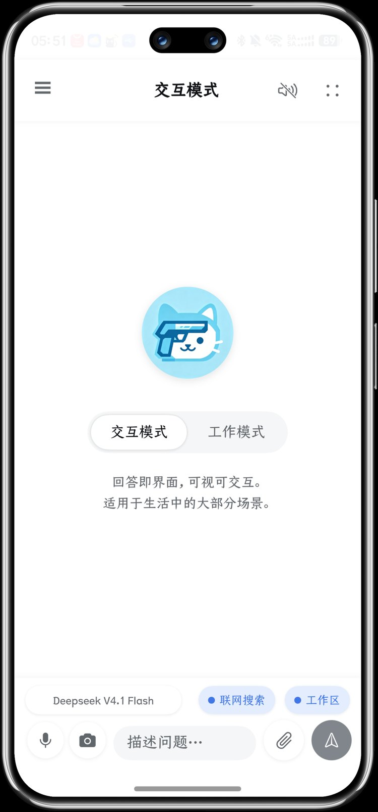
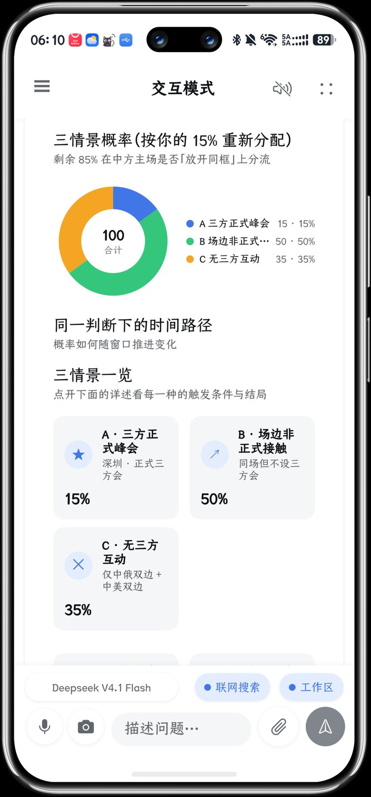

# Guncat Work（鸿蒙版）

> 中文 | [English](README_EN.md)

**鸿蒙手机上的原生 AI 工作台** —— 用 ArkTS / ArkUI 从零构建，非套壳。**鸿蒙手机可用，不止鸿蒙电脑**：**原生 `shell`**（mksh + toybox/libarchive/git/ssh/node，命令是 HarmonyOS `.so`，不经虚拟机）与**原生 CPython 3.12**（编成 HarmonyOS `.so` 在进程内直跑，numpy / pandas / scipy / matplotlib 全离线）都在机内真跑，**47 个工具 + 32 个技能**的 Agent Loop 端侧闭环，**Intelligent UI**（一句话直出可操作界面）与 **Harness**（多轮工具循环 + 沙箱工作区）两种当红形态真机跑通，PPT / Word / Excel / 绘图端侧直出。

电脑版见 [Guncat Work（电脑版）](https://github.com/zhubowen-bot/Guncat-Work-for-pc)（Electron 38）。

安卓版见 [Guncat Work（安卓版）](https://github.com/zhubowen-bot/Guncat-Work-for-android)（Java 壳 + WebView（SPA））。

<!-- 演示位（可选升级）：真机录屏 30–60 秒 —— 进工作模式 → 一句话生成 PPT → 产物卡片展开 → 切到交互模式拖滑块重算。动态 GIF 比静态截图更有说服力。 -->

-blue)


[](LICENSE)
[](https://github.com/zhubowen-bot/Guncat-Work-for-hmos/actions/workflows/ci.yml)

<p align="center">
  <a href="docs/images/interactive-home.jpg"></a>
  <a href="docs/images/interactive-ui.jpg"></a>
  <a href="docs/images/work-delivery.jpg"></a>
  <a href="docs/images/run-js.jpg"></a>
</p>

<p align="center"><sub>交互模式首页 · 交互模式直出的可操作界面 · 工作模式长程任务交付 · <code>run_js</code> 设备内 JS 沙箱　（点击任意一张放大）</sub></p>

## 手机上真的能跑什么

- ⚡ **原生 shell，不是"模拟一个 shell"**：`shell` 工具的命令都是 HarmonyOS 原生 `.so`（mksh、toybox、libarchive、git、dropbear、node），由 IEC 执行核 fork 后直接跑——**没有虚拟机、没有指令翻译、不需要 JIT 权限**；管道 / 重定向 / 通配符 / `sed` / `awk` / `find` / `tar` / `git` / `ssh` 全是真的，单条命令 0.2~1.5 秒。工作目录与本会话工作区是**同一份文件系统**：`cat data/a.csv` 与 `read_file("data/a.csv")` 读的是同一份内容，不是副本。
- 🐍 **原生 CPython 3.12，不是仿真**：解释器编成 HarmonyOS 原生 `.so`，在应用进程内直接跑（不经指令翻译，比早期的虚拟机解释执行快 2~3 个数量级）；numpy / pandas / **scipy** / matplotlib / python-docx / python-pptx / reportlab / sympy 等随包离线可用，中文开箱能画。
- 🧠 **端侧 AgentLoop**：47 个内置工具 + 32 个技能，多轮工具循环、子代理并行派发、定时提醒 / 自主目标 / 会话事件检索、上下文三级压缩——长程任务在手机上自己跑完，产物落在沙箱工作区。
- 📊 **端侧直出交付物**：PPT / Word / Excel / SVG 由本地生成器产出（JSON 中间层，可无损读回、算子式编辑）；PDF 与 Office 全部本地解析，**不消耗多模态配额**。
- ✦ **Intelligent UI**：一句话进来，一张能拖、能点、改参数即时重算的原生界面出去——图表、表格、指标卡、选项卡、表单控件全部原生渲染。

## 两个当红形态，都在端侧真机跑通

| 形态          | 对标                                           | 在 Guncat Work 里的样子                                                                 |
| ----------- | -------------------------------------------- | ---------------------------------------------------------------------------------- |
| ✦ **交互模式**  | GPT 的 **Intelligent UI**                     | 一句话进来，一张**能拖、能点、能改参数并即时重算**的原生界面出去：图表 / 表格 / 指标卡 / 选项卡 / 表单控件全部原生渲染，默认零工具调用、一轮直出   |
| 🛠 **工作模式** | **DeepSeek Harness**（dsh，Codex 式 Agent Loop） | 多轮工具循环 + 每会话独立沙箱工作区 + 47 个内置工具，长程任务自主执行，端侧直出 PPT / Word / Excel / SVG，产物卡片附行级 diff |

两个形态**共用同一套 Agent Loop 与沙箱工作区**，差别在行为纪律与**下发的工具面**——工作模式是「47 个内置工具全量 + 多轮工具循环 + 长程交付」，交互模式只下发 **27 个**（读素材 / 算真实数字 / 核实外部事实 / 出文件），长程工具（`todo_write` / `goal_*` / `schedule_*` / `subagent` …）根本不出现在它的请求里，所以是「快车道、一轮直出界面」。应用启动默认落在交互模式，空态大标题处的「交互模式 / 工作模式」胶囊可一键换挡。

两者底下是**同一套端侧执行环境**：需要真终端时落到完整 Linux `shell`，需要算数据时用原生 CPython，需要出文件时走本地 Office 生成器——全部在机内完成，不依赖任何远程执行服务。

交互模式复刻的是 GPT 那套 Intelligent UI 的交付方式：回答不再是纯文本，而是一份**界面程序**，由应用渲染成原生可操作界面——柱状 / 折线 / 面积 / 横向条 / 饼环 / 径向 / 雷达 / 堆叠条、表格、指标卡、图片墙、选项卡 / 折叠面板 / 步骤条 / 卡片块，以及整套表单控件（滑块 / 开关 / 单选 / 多选 / 下拉 / 标签选择 / 选项卡 / 输入框 / 文本域）；控件的取值还能回传模型触发重算。工作模式则把 DeepSeek Harness（dsh）的核心 Agent Loop 完整移植到了端侧。

对上游的研究材料也在仓库里：[open-intelligent-ui 规格](docs/reference/open-intelligent-ui-spec.md) · [openui-lang 规范](docs/reference/openui-lang-spec.md)。

## 这是什么

Guncat Work 是**鸿蒙手机上的原生 AI 工作台**：它不只负责对话，还把"干活需要的东西"搬进了手机——一个真正的 Linux、一个原生 Python、一套能读写工作区的工具，以及一条能把结果直接交付成文件的链路。

聊天模式内置通用、论文转换、法律 / 研究 / 筛滤检索与 LLM 评测等智能体；支持 Chat / Responses / Anthropic 三种主流协议接入、原生 Markdown（含 LaTeX 公式与 Mermaid 图表）、图片文档直传、CoreSpeechKit 朗读和原生语音输入等扩展 C 端功能。

工作模式带沙箱工作区与工具调用能力，包含 47 个内置工具，覆盖文件增删改查与模式匹配搜索、任务清单、图片查看、网络下载、PDF 解析、Office 生成与读写编辑（PPT / Word / Excel 各自基于 JSON 中间层，可无损读回、算子式编辑）、数据管道清洗转换与格式互转、基于 JSVM-API 的 JS 执行沙箱 `run_js`，**设备内原生执行的 `shell`** —— 命令都是 HarmonyOS 原生 `.so`（mksh、toybox、libarchive、git、dropbear、node），由 IEC 执行核 fork 后直接跑，没有虚拟机、没有指令翻译、不需要 JIT 权限，工作目录与本会话工作区是同一份文件系统；以及**原生 CPython 的 `run_python`** —— 解释器编成 HarmonyOS 原生 `.so` 在应用进程内直接跑（shell 里的 `python3` 也指向同一个解释器）。内置 32 个技能（5 个主 Skill 路由 + 7 个格式分支）把 PPT 设计规范、Doc JSON 语法、数据清洗配方等领域知识按需加载给模型。Office 文档与 PDF 全部本地解析，不消耗多模态配额。

界面在手机与桌面之间自适应：宽屏（≥700vp）展开「左侧栏 / 会话列 / 工作区详情列」三栏布局，窄屏回退单列加抽屉。工作区文件可原地预览、一键分享，生成与改动附行级 diff，对话历史、配置与朗读偏好均本地持久化。工程上采用 MVVM 分层，三协议 SSE 统一进协议适配层，每个文档生成器都配有针对性的离线验证环境（Node 构建 + Python 结构校验 + tsc 类型检查）。

当前应用版本：`7.0.0` · 完整变更见 [更新记录](CHANGELOG.md)

## 能力概览

- **两种当红 Agent 形态**：**交互模式**对标 GPT 的 Intelligent UI —— 一句话进来，一张能操作的界面出去，默认零工具调用、一轮直出，界面里的滑块、开关、下拉即时重算；**工作模式**是 DeepSeek Harness 的端侧移植 —— 多轮工具循环 + 沙箱工作区 + 长程交付（产物卡片附行级 diff）。
- **原生 shell（无虚拟机）**：`shell` 工具里的命令都是 HarmonyOS 原生 `.so`（mksh、toybox、libarchive 的 tar/unzip/zip/cpio、git、ssh/scp、node），由 IEC 执行核 fork 后直接跑，管道 / 重定向 / 通配符 / `sed` / `awk` / `find` / `tar` / `git` 全部是真的；工作目录与本会话工作区是同一份文件系统（`cat data/a.csv` 与 `read_file("data/a.csv")` 是同一份文件）。无冷启动，单条命令 0.2~1.5 秒。
- **原生 CPython，不是仿真**：`run_python` 把 CPython 3.12 编成 HarmonyOS 原生 `.so`，在应用进程内直接跑；numpy / pandas / scipy / matplotlib / Pillow / lxml / sympy / python-docx / python-pptx / reportlab 等随包离线可用，中文开箱能画；shell 里的 `python3` 也指向同一个解释器（新进程，`PYTHONHOME` 已接好）。
- **端侧直出 Office**：PPT / Word / Excel / SVG 由本地生成器产出，基于 JSON 中间层，文档可无损读回、算子式编辑；PDF 与 Office 全部本地解析，不消耗多模态配额。
- **47 个内置工具**：文件增删改查与模式匹配搜索、任务清单、图片查看、网络下载、PDF 解析、Office 读写、数据管道清洗转换与格式互转、JSVM-API 的 `run_js` 代码沙箱（不联网、不读写文件系统，后台线程执行并带超时保护），以及上面那套 `shell` / `run_python` 执行能力。
- **三协议接入**：OpenAI Completions（`/chat/completions`）、OpenAI Responses（`/responses`）、Anthropic Messages（`/messages`），均支持图片直传；深度思考与联网搜索按各协议显式控制。
- **内置本地联网搜索**：软件内置、无需手动开关，工作模式与聊天模式都能调用，不受制于服务端联网开关。
- **32 个技能**：5 个主 Skill 路由 + 7 个格式分支，命中即按需加载；PPT / Word / Excel 三个技能采用「门」式约束，交付前生成可核对的自检报告。
- **原生 Markdown**：CommonMark 与 GFM 常用语法、代码高亮、表格、任务列表、LaTeX 行内与块级公式、Mermaid 图表，深浅色主题自动适配。
- **附件与分享**：图片 / 文档直传或预解析、256px 缩略图、快捷拍照、导出 Markdown 回答为 Word（含 LaTeX → OMML 原生公式）、接收 HarmonyOS 系统分享。
- **语音**：CoreSpeechKit 朗读（可切换系统音色与倍速、支持锁屏与后台继续、控制条可拖动）与原生语音输入。
- **自适应界面**：宽屏三栏、窄屏单列加抽屉；跟随系统切换深浅色主题，并同步状态栏、导航栏与 Markdown 样式。

完整功能清单与实现细节见 [主要功能](docs/features.md)。

## 快速开始

### 环境要求

- DevEco Studio 6.0.1 或兼容版本
- HarmonyOS SDK API 24（`6.1.1`）
- HarmonyOS 手机真机（平板 / 2in1 亦可，宽屏自动展开三栏布局）

### 构建

使用 DevEco Studio 打开项目后，配置签名并运行 `entry` 模块即可。命令行构建示例：

```bash
hvigorw --mode module -p product=default -p module=entry@default -p buildMode=debug assembleHap
```

构建步骤：

1. 克隆或下载项目。
2. 还原大体积随包库：`bash scripts/prepare-big-libs.sh`（仓库里 `libnode.so` 存为
   `libnode.so.xz`，约 23MB；GitHub 拒绝 >100MB 单文件。跑过 `build_node.sh` 的
   可跳过，已存在的 `.so` 不会被覆盖）。
3. 使用 DevEco Studio 打开**仓库根目录**。
4. 安装并选择 HarmonyOS SDK API 24。
5. 配置调试或发布签名。
6. 连接 HarmonyOS 真机。
7. 运行 `entry` 模块，或使用上述命令构建 HAP。

### Shell 工具（IEC 原生执行核）的额外产物

`shell` 工具依赖随包的 HarmonyOS 原生 `.so`（已入库，随 HAP 的 `libs/arm64-v8a/` 分发）。
执行核本身是 `libiec_server.so`（exec/tty 服务、loader、shim）；命令 → `.so` → 入口与
`IecRuntime.ets` 的 `add(...)` 一一对应：

| 命令 | 随包 `.so` | 入口 |
| --- | --- | --- |
| `sh` / `mksh` | `libmksh.so` | `main` |
| `toybox` 及 70+ applet（`ls/cat/grep/sed/awk/find/xargs/…`） | `libtoybox.so` | `bsh_toybox_main` |
| `tar` / `bsdtar` | `libbsdtar.so` | `iec_bsdtar_main` |
| `unzip` | `libbsdunzip.so` | `iec_bsdunzip_main` |
| `cpio` / `bsdcpio` | `libbsdcpio.so` | `iec_bsdcpio_main` |
| `zip` | `libzipcmd.so` | `iec_zip_main` |
| `git` / `git-upload-pack` / `git-receive-pack` / `git-upload-archive` | `libgit.so` | `iec_git_main` |
| `git-remote-http` / `git-remote-https` | `libgit-remote-http.so` | `iec_git_remote_http_main` |
| `ssh` / `scp` / `ssh-keygen` / `dbclient` / `dropbearkey` / `dropbearconvert` / `dropbear` | `libdropbear.so` | `iec_dropbear_main` |
| `sftp` | `libsftpcmd.so` | `iec_sftp_main` |
| `jq` | `libjqcmd.so` | `iec_jq_main` |
| `curl` | `libcurlcmd.so` | `iec_curl_main` |
| `bc` | `libbccmd.so` | `iec_bc_main` |
| `nc` | `libnc.so` | `iec_nc_main` |
| `hexdump` / `hd` | `libhexdump.so` | `iec_hexdump_main` |
| `diff`（后端是随包 git） | `libdiff.so` | `iec_diff_main` |
| `node` / `nodejs` | `libnode.so` | `iec_node_main` |
| `npm` | `libnode.so` | `iec_npm_main` |
| `npx` | `libnode.so` | `iec_npx_main` |
| `python3` / `python` | `libpycmd.so` + `libpython3.12.so` | `iec_python_main` |

`libnode.so` 是 node 22.19；npm 的纯 JS 树在 `rawfile/tools/npm.tar.gz`，首次启动解到资源根。
`python3` / `python` 与 `run_python` 共用同一个 `libpython3.12.so`，但由独立的 python runner
进程承载（`libpycmd.so` 只是 UDS 客户端）。

在 WSL2 + Linux 版 HarmonyOS SDK 下重建（脚本会按需拉取源码、交叉编译并直接放进 HAR 的 `libs/`）：

```bash
export OHOS_SDK=/opt/ohos-cmdline/command-line-tools/sdk/default/openharmony
tools/build-iec-runtime.sh          # zlib → openssl → pcre2 → curl → libarchive → git → dropbear
tools/build-iec-runtime.sh node     # V8，最久（约 85MB 源码）
```

GitHub 直连在 WSL 里通常不通（codeload 可用）：`pcre2` / `git` / `dropbear` 的源码需先在
Windows 侧 `git clone` 到 `third_party/bettersh/iec/thirdparty/` 下。

`node` 另有两个宿主前提：Python 3.8–3.13（3.14 可临时放宽 `configure` 的版本表）和
**GCC ≤13**——node 22 的 V8 在 GCC 15 下编不过（`std::formatter<subrange>`/ranges 报错）。
当前仓库已随包 `libnode.so`（node 22.19）；只有重建时才需要满足上述宿主条件。

HAP 约 452.7 MB（约 432 MiB；精确字节数随构建与签名变化；原生命令集 + CPython + 运行库）。某个 `.so` 缺失时，对应的 launcher 不会注册，
命令会干净地报 `command not found`，不影响其它命令。

### 首次配置

应用设置中可保存并切换多套 API 配置：

1. 接入方式（`openai-completions` / `openai-responses` / `anthropic-messages`）
2. Base URL
3. API Key
4. Model
5. Temperature、Top P、最大输出 Token 等可选参数
6. 额外请求参数

常用兼容地址：

- DeepSeek Responses：`https://api.deepseek.com`
- DeepSeek Anthropic：`https://api.deepseek.com/anthropic`，也可直接填 `https://api.deepseek.com`（应用自动补全 `/anthropic/v1/messages`）
- 火山方舟 Responses：`https://ark.cn-beijing.volces.com/api/v3`
- Anthropic Messages：`https://api.anthropic.com/v1`

多模态预解析可单独配置模型、地址和 API Key。

### 验证

- **一键本地检查（推荐）**：`bash scripts/check-all.sh`（`--fast` 跳过较慢/依赖环境的项，`--list` 查看 18 项清单）
- **IEC hexdump 属性对拍**：`bash third_party/bettersh/iec/tests/hexdump_fuzz/run.sh`（200 组随机输入 × `-C/-b/-c/-x/-d/-o` × `-n/-s/-v`，与系统 `hexdump` 逐字节比较；已接入 `check-all.sh`，没有系统 `hexdump` 时 SKIP）
- **IEC nc 属性/边界**：`bash third_party/bettersh/iec/tests/nc_fuzz/run.sh`（10MB 双向、两个方向半关闭、并发、端口复用、SIGTERM、二进制安全）
- **IEC diff 属性/边界**：`bash third_party/bettersh/iec/tests/diff_fuzz/run.sh`（100 对随机文件与 `git diff --no-index` 逐字节对拍，加选项/路径/权限/8MB）
- **mksh 64 位算术回归**：`bash third_party/bettersh/iec/tests/mksh_arith/run.sh`（同一份源码编 64/32 位对照 + Python 大整数对拍；已接入 `check-all.sh`）
- **toybox 解析交叉验证**：`bash third_party/bettersh/iec/tests/toybox_parse/run.sh`（宿主编 toybox 拿真实 applet 输出，验证显式命令不被覆盖）
- **CA bundle 可用性**：`bash third_party/bettersh/iec/tests/ca_bundle/run.sh`（121 张根证书、CMake/ArkTS 接线，curl/python/git 用空 capath 做真握手；无网 SKIP）
- **npm 解包宿主回归**：`bash third_party/bettersh/iec/tests/npm_unpack/run.sh`（2697 条目与 bsdtar 参考树逐文件比对，截断/只读失败路径）
- **IEC 原生代码宿主回归**：`bash third_party/bettersh/iec/scripts/test_iec_native_host.sh`（exec 路由 / cwd 校验 / NCP 拒绝分类 / fs shim 路径映射；已接入 `check-all.sh`，不需要设备或 OHOS SDK）
- **IEC exec 会话压测**：`bash third_party/bettersh/iec/scripts/stress_exec_session.sh`（8 路并发整条流上限 / 中途终止 / 50 轮 fd 与 RSS / 200 次短会话 / 0-1-50ms 超时；已接入 `check-all.sh`，`--fast` 跳过，不需要设备或 OHOS SDK）
- 纯逻辑回归（当前 **754 项**全绿）：`cd test/guncat-harness && node setup.mjs && node test-core.mjs`
- 服务层类型检查：`cd test/guncat-harness && node check-setup.mjs && npx -y -p typescript@5.5.4 tsc -p check/tsconfig.json`
- PPT / Word / Excel 离线验证环境：`test/pptx-harness`、`test/docx-harness`、`test/xlsx-harness`
- **真机验收**（装一次 HAP，逐项确认 shell / IEC）：[真机验收清单](docs/guides/device-verification.md)
- 真实 ArkTS 编译（需本机 DevEco）：`powershell -ExecutionPolicy Bypass -File tools/build-check.ps1`

最后一层不能省：ArkUI 有一批**只有编译器才知道**的规则（`@Builder` 方法体内不允许声明局部变量、自定义组件属性名不能与内置属性同名、`@Prop` 的 null 需要显式联合类型），而 node 侧 harness 只覆盖 `common/**` 与 `service/**` 的纯 TS，不解析 `.ets`。

前两层与三个 Office 生成器验证**已接 CI**，每次 push 与 PR 自动跑（见顶部 CI 徽章）；第三层需要本机 DevEco Studio，请在提交前自行跑一次。

## 文档

| 文档                                                                   | 内容                                                            |
| -------------------------------------------------------------------- | ------------------------------------------------------------- |
| [主要功能](docs/features.md)                                             | 全部客户端功能与工程约定                                                  |
| [工作模式架构与维护指南](docs/architecture/work-mode.md)                        | Agent Loop、47 个工具、PPT / Word 生成链路、技能系统、`run_js` 沙箱、ArkTS 落地约束 |
| [Shell 工具：IEC 原生执行核](docs/architecture/iec-runtime.md)              | 命令 so 的 fork 执行、exec 会话 API、工作区一致性、并发与生命周期、构建链      |
| [原生 Python 与跨域桥（历史）](docs/architecture/native-python.md)       | CPython 交叉编译、`run_python` 执行模型、`npy` 桥协议与性能数据（虚拟机方案已删除） |
| [交互模式架构（Intelligent UI）](docs/architecture/interactive-mode.md)      | 提示词分叉、`guncat-ui lang` 契约、流式成形、交互闭环、扩展入口                      |
| [项目结构](docs/architecture/project-structure.md)                       | 目录布局、数据流、核心组件                                                 |
| [使用指南](docs/guides/usage.md)                                         | 分场景操作步骤                                                       |
| [常见问题](docs/guides/faq.md)                                           | 排障与已知行为                                                       |
| [内置智能体](docs/reference/builtin-agents.md)                            | 智能体清单与差异                                                      |
| [持久化与主题系统](docs/reference/persistence-and-theme.md)                  | 本地存储与主题实现                                                     |
| [工作区与会话数据的生命周期](docs/architecture/workspace-lifecycle.md)            | 磁盘布局、删除会话时的连带清理、启动清扫与四类残留对策                                   |
| [三端实现对照与对齐现状](docs/ALIGNMENT_STATUS.md)                              | 电脑版 / 安卓版 / 鸿蒙版逐项对照：外壳、命令执行、JS/Python、PDF、工作区、语音、后台，以及刻意的差异   |
| [后台任务方案](docs/BACKGROUND_JOBS_PLAN.md)                               | `run_in_background` / `job_*` 在手机端的可行性评估（暂缓）                  |
| [更新记录](CHANGELOG.md)                                                 | 4.2.0 → 7.0.0 全部版本变更                                          |
| [openui-lang 规范](docs/reference/openui-lang-spec.md)                 | `guncat-ui lang` 所对齐的上游语言实现级规范                                |
| [open-intelligent-ui 规格](docs/reference/open-intelligent-ui-spec.md) | 交互模式所对齐的上游 Generated-Answer UI 规格                             |

## 权限与系统能力

- `ohos.permission.INTERNET`：访问模型 API。
- `ohos.permission.MICROPHONE`：语音输入。
- `ohos.permission.KEEP_BACKGROUND_RUNNING`：朗读后台音频长时任务。
- 工作模式：文件读写全部在应用沙箱（`filesDir/workspaces/`）内完成，文件选择/保存走系统安全组件（DocumentViewPicker），**未新增任何权限**。
- Shell 工具（IEC 原生执行核）：命令是随包的 HarmonyOS 原生 `.so`，由 exec 服务 fork 后直接跑，**不需要 JIT/可执行内存等受限权限**；没有虚拟机、没有对外监听端口，网络走应用已有的 `INTERNET`；命令只能看到本会话工作区，看不到手机其它目录。
- Share Kit：接收其他应用分享的图片和文件。
- CoreSpeechKit：文本朗读与语音识别。
- AVSession Kit：后台媒体会话。
- ArkData Preferences：本地配置持久化；对话历史存沙箱文件 `filesDir/guncat_conversations.json`。

## 隐私说明

- API Key 和应用配置保存在应用本地沙箱。
- 聊天请求和附件只会发送到用户配置的模型服务。
- 从系统分享接收的内容不会自动发送，必须由用户主动点击发送。
- 原始附件不会作为永久文件复制到应用数据中。
- 网络请求使用 HTTPS，实际数据处理政策以所配置的模型服务商为准。

## 常见问题

遇到问题先看 [常见问题](docs/guides/faq.md)，涵盖 API Key 无效、文件解析失败、流式输出中断、图库分享列表缺失、交互模式界面没出来 / 只出一部分 / 参数调了数字没变等。

## 贡献

欢迎提交 Issue 和 Pull Request。开发环境、编码规范（ArkTS 硬约束）、三层验证怎么跑、PR 流程 → **[CONTRIBUTING.md](CONTRIBUTING.md)**。

1. Fork 仓库。
2. 创建功能分支。
3. 遵循 ArkTS 编码规范完成修改。
4. 确保项目通过类型检查和 HAP 构建。
5. 提交 Pull Request，并说明修改内容及验证方式。

## 说明

本次版本不包含曾经评估或试验过、但最终撤回的本地 TTS 模型方案；README 仅描述当前代码中实际保留的功能。

本项目基于 [Apache License 2.0](LICENSE) 开源。

**第三方组件声明**：`shell` 工具内含 IEC 执行核（MIT，[BetterSH](https://github.com/panedioic/iec) 的 `iec`）、mksh（MirOS）、toybox（0BSD）、libarchive（BSD-2-Clause）、git（GPL-2.0）、dropbear（MIT）、Node.js（MIT）等，均以独立 `.so` 分发；
逐项清单、源码获取方式与完整许可原文见 **[THIRD_PARTY_NOTICES.md](THIRD_PARTY_NOTICES.md)** 与 [`LICENSES/`](LICENSES/)（同一份声明也打进 HAP 的 `rawfile/licenses/`）。
